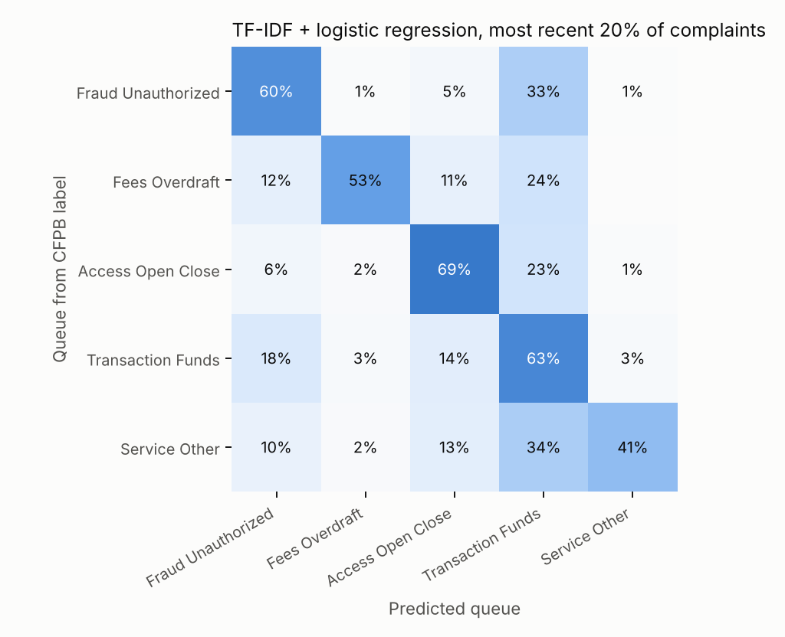

# Complaint Triage NLP: when is an LLM worth it?

Routing real bank and payments complaints to the right service queue, comparing a cheap TF-IDF model against an LLM, and measuring what the LLM actually buys per dollar.

**Status:** data pipeline, baseline, and evaluation harness are done and tested. LLM runs and the human-labeled gold set are in progress; their sections below are placeholders until those numbers exist.

## The business question

A client-service team gets thousands of free-text complaints. Each one must reach the right queue fast, and a few (fraud, vulnerable clients, legal threats) must be escalated immediately. Three questions:

1. How well does a cheap, explainable model route complaints?
2. How much better is an LLM, and at what cost per 1,000 complaints?
3. Can a hybrid (cheap model first, LLM only when unsure) get most of the gain at a fraction of the cost?

## Data

Real consumer complaints from the [CFPB Consumer Complaint Database](https://www.consumerfinance.gov/data-research/consumer-complaints/), checking/savings and money-transfer products, Jan 2021 to Feb 2024.

| | |
| --- | --- |
| Complaints with narratives (after cleaning) | 13,584 |
| Train (oldest 80%) | 10,867, Jan 2021 – Oct 2023 |
| Test (newest 20%) | 2,717, Oct 2023 – Feb 2024 |
| Median length | 180 words |

CFPB stopped publishing complaint narratives in August 2026, so the live API now returns only categorical fields. The narratives here come from a December 2025 public snapshot, [BEE-spoke-data/consumer-finance-complaints](https://huggingface.co/datasets/BEE-spoke-data/consumer-finance-complaints) (CC0), shard `train-00000-of-00007`. The raw file is not committed; see `data/raw/README.md`.

Cleaning: CFPB's `XXXX` redactions are collapsed to one token, narratives under 20 words and exact duplicates are dropped.

### Labels: five service queues

CFPB's 30+ consumer-chosen issue/sub-issue pairs are mapped to five queues (`src/complaint_triage/taxonomy.py`). Fraud is checked first, because sending fraud to the wrong queue is the costliest error.

| Queue | Share | Example CFPB sub-issues |
| --- | --- | --- |
| Transaction / funds | 45% | Deposits and withdrawals; debit card problem; money not available when promised |
| Fraud / unauthorized | 23% | Fraud or scam; transaction was not authorized; account opened as a result of fraud |
| Access / open / close | 19% | Company closed your account; problem accessing account |
| Fees / overdraft | 8% | Overdraft fees; fee problem |
| Service / other | 5% | Didn't receive advertised terms; customer service |

**The labels are noisy by design.** Consumers pick the category from a dropdown while upset, and many complaints fit several queues. That noise caps any model's agreement with CFPB labels, which is why the project includes a human-labeled gold set.

## Results so far

### Baseline: TF-IDF + logistic regression

Trained on the oldest 80% and scored on the newest 20%, mirroring deployment.

| Metric | Value |
| --- | --- |
| Accuracy vs. CFPB-derived label | 61.4% |
| Macro F1 | 0.576 |
| Inference | ~0.3 ms per complaint on a laptop CPU |



What the errors say:

- **Most mistakes go to "Transaction / funds."** A third of fraud complaints and a third of service complaints are predicted as transaction problems. That is often defensible: "Zelle sent my money to a scammer" is both a fraud and a transfer.
- **No drift problem.** A random split gives the same accuracy (61.5%) as the time split, and the queue mix is stable quarter to quarter. The ceiling comes from the labels, not from time.
- **The model is learning sensible signal.** Top-weighted terms: *fraud, scam, unauthorized, zelle* (fraud); *overdraft, fee, overdrawn* (fees); *closed, closure, branch* (access); *bonus, promotion, advertised* (service).

### LLM zero-shot and few-shot — in progress

One call per complaint returns JSON: queue, confidence, four escalation flags, dollar amount in dispute, and a one-sentence rationale. Results will be reported on the same fixed 500-complaint test sample as the baseline, with parse-failure rate, tokens, latency, and cost per 1,000 complaints.

### Hybrid routing — in progress

`evaluate.hybrid_sweep` sends a complaint to the LLM only when the baseline's confidence is below a threshold, and traces accuracy against the share of traffic that reaches the LLM.

### Human gold set — in progress

150 test complaints (30 per queue), labeled without seeing any model's prediction. This measures (a) how often the CFPB label itself is wrong, (b) each model's accuracy against human judgment, and (c) precision and recall of the escalation flags, which have no CFPB label at all.

## How it works

```
CFPB export ──► data.py: clean, dedupe, map to queues, time split
                   │
        ┌──────────┴───────────┐
   baseline.py              llm.py: prompt → JSON → validate → cache
   TF-IDF + LogReg          (zero-shot / few-shot, Anthropic or OpenAI)
        └──────────┬───────────┘
              evaluate.py: metrics, cost, hybrid sweep, gold-set scoring
```

Design choices that matter in a regulated setting:

- **Every LLM response is cached** by model, prompt version, and complaint ID. Re-runs are free, results are reproducible, and the raw outputs are kept for audit.
- **Invalid LLM output is a failure, not a guess.** A response with no valid JSON or an unknown queue is counted as wrong in accuracy, and the hybrid router falls back to the baseline.
- **Rule-based escalation flags** (`flags.py`) are a transparent benchmark the LLM flags must beat.
- **Annotation is blind.** The gold-set file excludes model predictions so the labeler is not anchored.

## Run it

```bash
pip install -e ".[llm,dev]"
# put the CFPB export at data/raw/complaints.csv (see data/raw/README.md)
make prepare baseline        # data + baseline, no API key needed
cp .env.example .env         # add ANTHROPIC_API_KEY (or OpenAI) and prices
make llm N=500               # zero-shot + few-shot on the same 500 complaints
make compare                 # comparison table, F1-by-queue and hybrid charts
make gold                    # 150-complaint annotation file
make gold-eval               # after filling gold/annotation_labeled.csv
make test                    # 10 tests, no network or API key needed
```

## Limitations

- CFPB complaints are filed by consumers who escalated outside the firm, so they skew toward severe, unresolved cases.
- Labels are consumer-selected and noisy; agreement with them is a proxy, and the gold set is the real yardstick.
- Narratives are redacted, which removes names, dates, and some amounts.

## License

Code: MIT. Data: CFPB public data via a CC0 snapshot.
